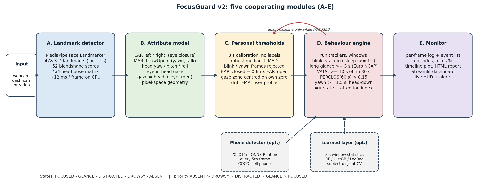

# FocusGuard v2: Real-Time Distraction & Drowsiness Detection


FocusGuard watches a person through an ordinary webcam and tells you, frame by frame, whether they are **focused, glancing away, distracted, drowsy or absent**. It also gives a 0–100 **attention index**. Everything runs locally on a CPU at about 60–75 FPS. You don't need a GPU, labelled training data or an internet connection once it's installed.

It has two modes:
- **Screen** (default): a student or worker at a desk
- **Driving**: driver monitoring, following the Euro NCAP timing rules

---

## Contents
- [Requirements](#requirements)
- [Installation](#installation)
- [Check that it works](#check-that-it-works)
- [Usage](#usage)
- [Command-line options](#command-line-options)
- [Output files](#output-files)
- [Dashboard](#dashboard)
- [How it works](#how-it-works)
- [Project structure](#project-structure)
- [Troubleshooting](#troubleshooting)
- [Privacy](#privacy)
- [Acknowledgements](#acknowledgements)

---

## Requirements

- **Python 3.10 or newer** (tested with 3.13)
- Windows, macOS or Linux
- A webcam, or a video file to analyse
- About 500 MB of disk space for the Python packages

The two model files are already in `models/`, so nothing else needs downloading.

## Installation

```bash
git clone https://github.com/alanminu/focus-guard.git
cd focus-guard

python -m venv .venv
```

Activate the virtual environment:

| OS | Command |
|---|---|
| Windows (PowerShell) | `.venv\Scripts\Activate.ps1` |
| Windows (cmd) | `.venv\Scripts\activate.bat` |
| macOS / Linux | `source .venv/bin/activate` |

Then install the packages:

```bash
pip install -r requirements.txt
```

> No Git on the laptop? On the GitHub page click **Code → Download ZIP**, unzip it, open a terminal in the folder, and continue from `python -m venv .venv`.

## Check that it works

Run these from the project folder with the virtual environment active. Neither needs a camera.

**1. Unit tests** (a few seconds):
```bash
python -m pytest -q tests
```
Expected: `19 passed`.

**2. Synthetic benchmark** (about 10 seconds). This runs the full decision logic on simulated drivers and prints a results table:
```bash
python scripts/eval_synthetic.py --subjects 3 --out results/synthetic
```
The `FocusGuard (calibrated)` row should show far fewer false alarms per hour than the `V1` row.

**3. Live webcam test:**
```bash
python -m focusguard.cli --source 0 --out runs/test
```
A window opens with the camera feed and an overlay. **For the first 8 seconds, look at the screen normally.** That's the calibration. Then try looking away for 3+ seconds, closing your eyes, or yawning, and watch the state change. Press `q` to quit. A session summary is printed and saved to `runs/test/`.

## Usage

```bash
# Webcam, desk / e-learning mode
python -m focusguard.cli --source 0 --out runs/me

# Driver monitoring with the phone detector
python -m focusguard.cli --source 0 --context driving --phone --out runs/drive

# Analyse a recorded video without a window and save an annotated copy
python -m focusguard.cli --source my_video.mp4 --out runs/video --no-display --save-video

# Reuse your calibration from an earlier session (skips the 8 s calibration)
python -m focusguard.cli --source 0 --profile runs/me/profile.json
```

**Keys in the live window:** `q` quits, `r` recalibrates.

**States shown on screen:**

| State | Meaning |
|---|---|
| `CALIBRATING` | Learning your normal eye level, head pose and gaze (first 8 s) |
| `FOCUSED` | Looking at the screen or road |
| `GLANCE` | Briefly looking away (normal, no alert) |
| `DISTRACTED` | Looking away ≥ 3 s, ≥ 10 s total in 30 s, head down, or using a phone |
| `DROWSY` | Eyes closed ≥ 1 s, high PERCLOS, or repeated yawning |
| `ABSENT` | No face visible for ≥ 2 s |

## Command-line options

| Flag | Default | Description |
|---|---|---|
| `--source` | `0` | Webcam index (`0`, `1`, …) or path to a video file |
| `--out` | none | Folder for logs and the report |
| `--context` | `screen` | `screen` or `driving` |
| `--phone` | off | Turn on the YOLO11n phone detector |
| `--profile` | none | Load a saved `profile.json` and skip calibration |
| `--no-calibration` | off | Use default thresholds instead of calibrating |
| `--no-display` | off | Run without a window |
| `--save-video` | off | Write `annotated.mp4` to `--out` |
| `--stride` | `1` | Process every Nth frame (faster on slow laptops) |
| `--max-seconds` | none | Stop after N seconds |

## Output files

With `--out runs/<name>`, each session writes:

| File | Contents |
|---|---|
| `report.html` | Session report you can open in a browser |
| `timeline.png` | Attention index, states, gaze and eye/mouth signals over time |
| `summary.json` | Time in each state, attention score, counts of blinks, glances, yawns… |
| `frames.csv` | Per-frame features, state and attention index |
| `events.csv` | Each detected event (blink, glance, yawn, …) |
| `episodes.csv` | Each continuous distraction or drowsiness episode |
| `profile.json` | Your calibration, reusable with `--profile` |
| `config.json` | The exact thresholds used |

## Dashboard

```bash
streamlit run dashboard/app.py
```
It opens in your browser. You can:
- browse and compare every session saved in `runs/`
- upload a video and analyse it (only numbers are kept, never frames)

## How it works

<p align="center">
  
</p>

| Module | File | Role |
|---|---|---|
| **A** Landmark detector | `focusguard/detector.py` | MediaPipe Face Landmarker: 478 landmarks, 52 blendshapes, head pose |
| **B** Attribute model | `focusguard/features.py` | Eye aspect ratio, mouth aspect ratio, head yaw/pitch/roll, gaze |
| **C** Personal thresholds | `focusguard/calibration.py` | 8 s calibration (median/MAD), then slow drift tracking |
| **D** Behaviour engine | `focusguard/behavior.py` | Temporal rules → state + attention index |
| **E** Monitor | `focusguard/monitor.py` | Logs, statistics, reports |
| Phone detector (optional) | `focusguard/phone.py` | YOLO11n via ONNX Runtime, every 5th frame |

**Why temporal rules?** A single frame with closed eyes is a blink, which is normal. The same thing for one second is a microsleep. FocusGuard looks at how long each behaviour lasts:
- blink (< 0.5 s) vs. microsleep (≥ 1 s)
- long glance: ≥ 3 s looking away in one go (Euro NCAP)
- VATS: ≥ 10 s looking away in total within 30 s (Euro NCAP)
- PERCLOS: eyes closed more than 15 % of the last 60 s
- yawn ≥ 1.5 s, head down ≥ 2 s, face missing ≥ 2 s

All thresholds are in [`focusguard/config.py`](focusguard/config.py) if you want to tune them.

## Project structure

```
FocusGuard/
├── focusguard/            # the application
│   ├── cli.py             # command-line entry point
│   ├── pipeline.py        # connects modules A–E
│   ├── detector.py        # A: face landmarks
│   ├── features.py        # B: eye, mouth, head and gaze measurements
│   ├── calibration.py     # C: personal thresholds
│   ├── behavior.py        # D: temporal rules and states
│   ├── monitor.py         # E: statistics and reports
│   ├── overlay.py         # on-screen display
│   ├── phone.py           # optional phone detector
│   ├── ml.py              # optional learned layer
│   ├── simulate.py        # simulated drivers for testing
│   └── config.py          # all thresholds
├── models/
│   ├── face_landmarker.task   # MediaPipe face model (required)
│   └── yolo11n.onnx           # phone detector (optional)
├── dashboard/app.py       # Streamlit dashboard
├── scripts/               # benchmarks, evaluation and data collection
├── tests/test_core.py     # unit tests
├── assets/                # README images
└── requirements.txt
```

### Extra scripts (optional)

| Script | What it does |
|---|---|
| `scripts/eval_synthetic.py` | Benchmark on simulated drivers (no data needed) |
| `scripts/benchmark.py --video clip.mp4` | Measure speed per module on your laptop |
| `scripts/collect_protocol.py --subject S01` | ~4 min guided recording that labels itself (stores features only) |
| `scripts/train_model.py --data data/protocol` | Train and evaluate the learned layer on collected data |
| `scripts/extract_features.py`, `scripts/eval_sust.py` | Evaluation on the [SUST-DDD](https://github.com/EsraKavalci/Sivas-University-of-Science-and-Technology-Driver-Drowsiness-Dataset) dataset (download it separately) |

## Troubleshooting

| Problem | Fix |
|---|---|
| `cannot open source 0` | The webcam is in use by another app, or try `--source 1` |
| macOS: black window or camera error | Allow camera access for your terminal in **System Settings → Privacy & Security → Camera** |
| `pip install` fails on mediapipe | Check `python --version` is 3.10+ and 64-bit, then run `pip install --upgrade pip` |
| PowerShell won't activate the venv | Run `Set-ExecutionPolicy -Scope CurrentUser RemoteSigned` once |
| `models/face_landmarker.task` missing | Download it again: `curl -L -o models/face_landmarker.task https://storage.googleapis.com/mediapipe-models/face_landmarker/face_landmarker/float16/1/face_landmarker.task` |
| Low FPS | Add `--stride 2`, or leave out `--phone` |
| Wrong states all the time | Press `r` and recalibrate, looking normally at the screen for 8 s |

## Privacy

- Everything runs on your computer. No video is saved unless you use `--save-video`.
- FocusGuard measures observable behaviour (gaze, eye closure, head pose). It does **not** recognise emotions.
- Get informed consent before monitoring anyone else.

## Acknowledgements

- [MediaPipe](https://developers.google.com/mediapipe) Face Landmarker by Google (Apache 2.0)
- [Ultralytics YOLO11](https://github.com/ultralytics/ultralytics) for the phone detector. The YOLO11 weights (`models/yolo11n.onnx`) are licensed under **AGPL-3.0**.
- Euro NCAP Driver State Monitoring protocol for the timing rules
